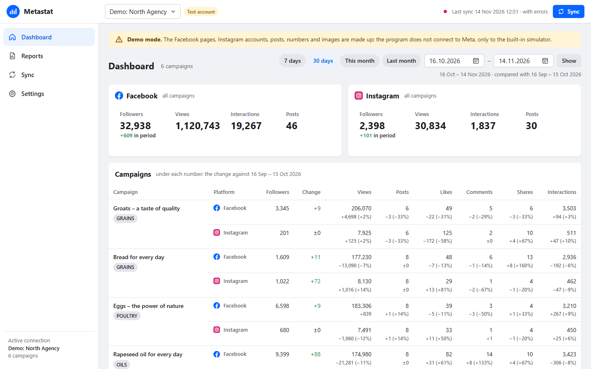
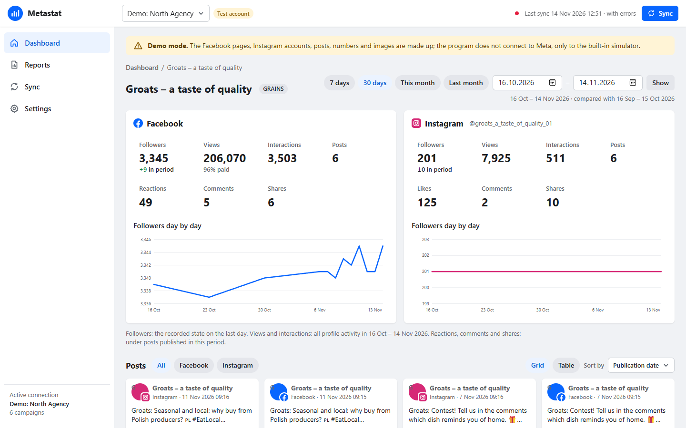
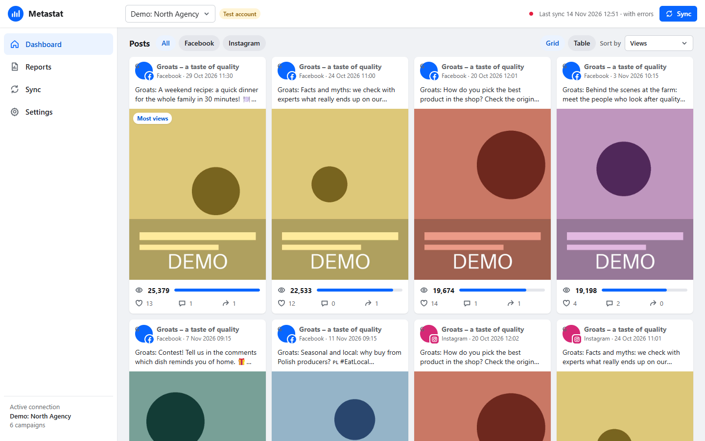
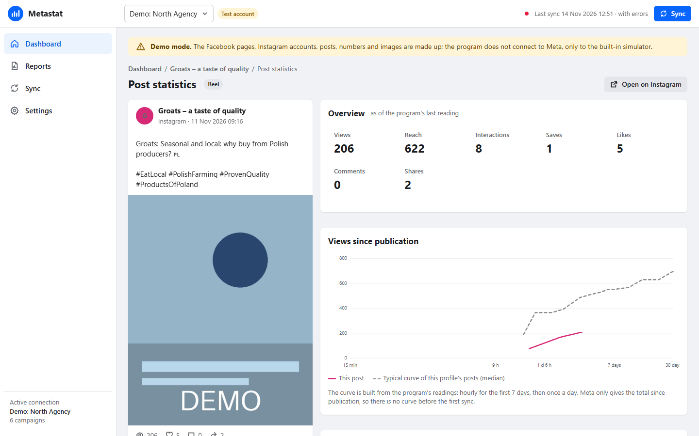
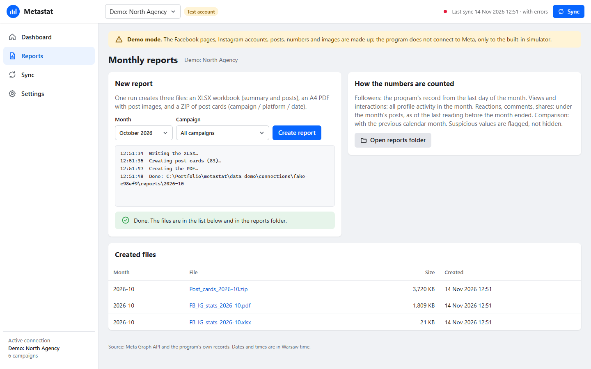
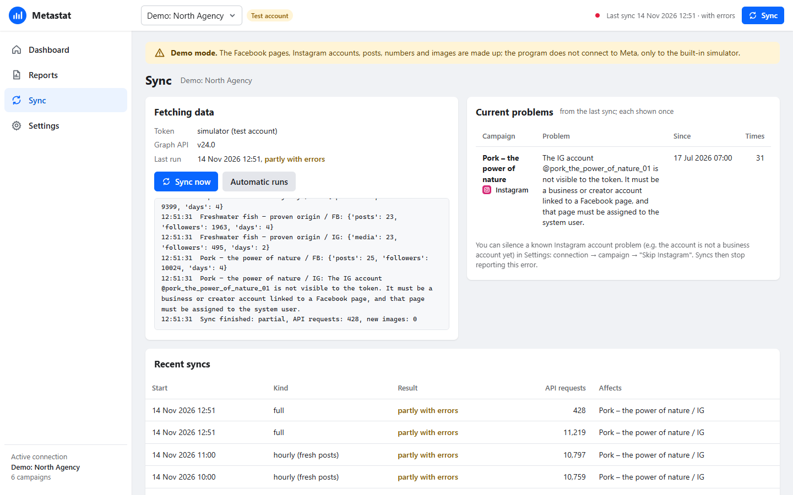
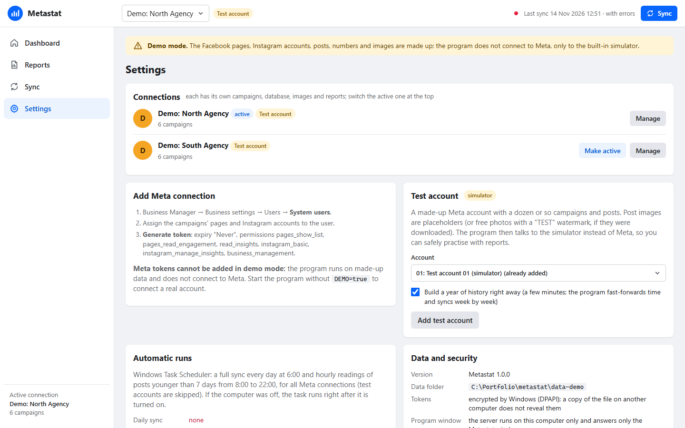
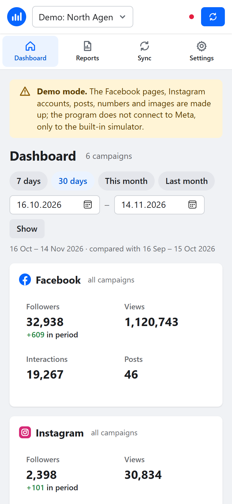

# Metastat

[](https://github.com/KlaneMir/Metastat/actions/workflows/tests.yml)
[](LICENSE)


Metastat is a Windows program that collects statistics for Facebook pages and Instagram accounts from the Meta Graph API and keeps their history. It records the state of each profile day by day, reads fresh posts every hour, downloads post images right away, and builds monthly reports as XLSX, PDF and a ZIP of post cards. It looks like Meta Business Suite but shows what Business Suite does not: many campaigns at once, a comparison with the previous period, and the view curve of every post since publication.

It was originally built for a Polish agency that runs a dozen or so campaigns at the same time, as an in-house replacement for paid data connectors. This public version is in English: the interface, the reports, the demo data and the installer. Dates and times are shown in Warsaw time.



## Run it in demo mode (no Meta account needed)

Demo mode works without a token and without internet. The Facebook pages, Instagram accounts, posts, numbers and images are made up, and the program talks to a built-in Meta Graph API simulator.

You need Windows 10 or 11, Python 3.11+ and Microsoft Edge (for the program window and the PDFs).

```bash
python -m venv .venv
```

```bash
.venv\Scripts\python -m pip install -e .
```

Then double-click **`Metastat-demo.cmd`** or run this in PowerShell:

```powershell
$env:DEMO = "true"; .venv\Scripts\python -m metastat
```

(In cmd: `set DEMO=true`, then `.venv\Scripts\python -m metastat` on the next line.)

On the first start the program creates two made-up accounts with 6 campaigns each and builds their history for the last 4 months. This takes about a minute, and the progress shows on the dashboard. Demo data goes into its own `data-demo\` folder, so it never mixes with real data. You can also turn demo mode on with a `DEMO=true` line in a `.env` file (see `.env.example`).

Everything works in demo mode except the connection to Meta and Windows Task Scheduler: syncing, XLSX/PDF/ZIP reports, settings and campaigns. The made-up campaigns include deliberate traps known from the real API: an Instagram account the API cannot see, a campaign without Instagram, and a new page with a broken follower history.

## Screenshots

| | |
|---|---|
|  |  |
| Campaign: FB and IG results, followers day by day | Posts: the bar under each image shows views on a shared scale |
|  |  |
| Post statistics: views since publication against the median of the profile's other posts | Reports: XLSX, A4 PDF and a ZIP of post cards |
|  |  |
| Sync: the run live, and each problem shown once with the date it first appeared | Settings: connections, tokens, campaigns, schedule |



## What it does

- Many connections in one program. A connection is a Meta token (a system user from Business Manager) or a simulator test account. Each one has its own campaigns, database, images and reports, and you switch the active one in the top bar.
- Campaigns from the token. After you paste a token, the program checks it with Meta, shows any missing permissions and lists the pages the token can access. You tick the ones that should become campaigns, and the program finds the linked Instagram account itself.
- History that Meta does not keep. The API only gives totals since publication, so the program stores its own readings: every hour for the first 7 days of a post, then once a day. From those it computes the growth in a month and the view curve.
- Post images right away. Image links in the API expire, so the program saves the original and an 800 px copy at sync time.
- A monthly report in three files: an XLSX workbook (summary and posts, compared with the previous month), an A4 PDF with post cards, and a ZIP of JPG cards laid out as `campaign/platform/date`. For October 2026 they are `FB_IG_stats_2026-10.xlsx`, `FB_IG_stats_2026-10.pdf` and `Post_cards_2026-10.zip`.
- Flags instead of hiding. A negative value, a follower jump above a threshold, or a drop from hundreds to a handful goes to a "To check" section. Metrics that Meta has retired are remembered and skipped.
- Automatic runs. Windows Task Scheduler runs a full sync at 6:00 and reads fresh posts every hour from 8:00 to 22:00, and it catches up after the computer was off.

## What it fetches from the Meta Graph API

API version: `v24.0` (you can change it in Settings). Token: a Business Manager system user with the `pages_show_list`, `pages_read_engagement`, `read_insights`, `instagram_basic`, `instagram_manage_insights` and `business_management` permissions (optionally `pages_read_user_content`). For pages the program uses page tokens fetched from `/{page-id}?fields=access_token`.

| Object | Call | Data |
|---|---|---|
| Token | `/me`, `/me/permissions`, `/me/accounts` | token owner, granted permissions, pages with a linked Instagram account |
| Facebook page | `/{page-id}` | name, link, follower count, linked Instagram account |
| Facebook page, daily | `/{page-id}/insights` | `page_follows`, `page_daily_follows_unique`, `page_daily_unfollows_unique`, `page_media_view` (with the `is_from_ads` paid/organic split), `page_total_media_view_unique`, `page_post_engagements`, `page_actions_post_reactions_total`, `page_video_views` |
| FB posts | `/{page-id}/posts` | date, text, link, image, type, shares, comment count, reactions (total and "like") |
| FB post | `/{post-id}/insights` | `post_media_view` (paid/organic), `post_total_media_view_unique`, `post_reactions_by_type_total`, `post_clicks_by_type`, `post_video_views` |
| IG account | `/{ig-user-id}` | name, followers, following, post count |
| IG account, daily | `/{ig-user-id}/insights` | `views`, `reach`, `accounts_engaged`, `total_interactions`, `likes`, `comments`, `shares`, `saves`, `follows_and_unfollows`, `follower_count` (30 days back, a Meta limit) |
| IG posts | `/{ig-user-id}/media` | date, caption, type (photo, video, carousel, reel), link, image, likes, comments |
| IG post | `/{media-id}/insights` | `views`, `reach`, `saved`, `shares`, `total_interactions`, `likes`, `comments` |

The program handles pagination (`paging.next`), the rate limit usage headers (`x-app-usage`, `x-business-use-case-usage`), retries with growing delays, and Meta's error codes (token, permissions, retired metric). You can check every metric in the list separately with `metastat probe`.

## Using it with a real account

1. In Business Manager, go to **System users → Add** (Admin role), assign the Facebook pages and Instagram accounts, and **Generate token** (expiry: Never) with the permissions from the table above.
2. Start the program without demo mode (`Metastat.cmd` or `python -m metastat`).
3. Open **Settings → Add Meta connection**, paste the token and pick the pages.
4. Click **Sync** in the top right corner, then **Settings → Automatic runs → Create tasks**.

Instagram accounts must be business or creator accounts linked to a Facebook page that is assigned to the system user; otherwise the API cannot see them.

## Security

- Tokens never sit in files as plain text. The program encrypts them with Windows DPAPI, so only the same Windows account on the same computer can read them. The window shows only the start and end of a token. A token from `.env` (an option for automation) is taken over on the first start and stored encrypted.
- The token never goes into request URLs or logs. It travels in the `Authorization` header, pagination included.
- The token goes only to the Graph API. Full URLs from API responses (`paging.next`) outside `graph.facebook.com` are rejected. Post images are downloaded over https only, also after a redirect, and only https links are clickable in the XLSX.
- The local server answers only the program window. It listens on `127.0.0.1`, draws a new key on every start (an `HttpOnly`, `SameSite=Strict` cookie), checks the `Host` header (against DNS rebinding) and where forms come from (`Sec-Fetch-Site`), and sends a CSP that allows only its own scripts.
- Odd data cannot break things. Campaign names cannot escape the report folder (for example `..` or `CON`), text starting with `=` does not become an XLSX formula, and a corrupt settings file falls back to its backup copy.
- The code contains no tokens or personal data; the `test_no_secrets_in_source` test checks this. The `bandit` scanner reports no medium or high issues, and `pip-audit` finds no known vulnerabilities.
- Where to keep the program with a real token: keep a source or portable copy inside your user profile (for example `C:\Users\<account>\Metastat`), not directly on `C:\`. Folders created in the root of the drive inherit write access for every user of the computer, so someone else could swap the code that runs with your token. The installer keeps data in `%LOCALAPPDATA%\Metastat` on its own.

## How it is built

- Python 3.11+, `httpx`, SQLite (long format: object, time, metric, value), and `FastAPI` + `Jinja2` + `uvicorn` for the interface, which runs in an Edge window in app mode. Charts are SVG rendered on the server.
- Reports: `openpyxl` (XLSX) and Playwright driving the installed Edge (A4 PDF and JPG cards).
- A Meta Graph API simulator (`src/metastat/fakeapi`): 10 made-up accounts with campaigns and a year of posts, with the same requests, pagination, page tokens, errors and retired metrics as the real API, plus a clock for "fast-forwarding time". The tests and demo mode both use it.
- Distribution: PyInstaller (`Metastat.exe`) and an Inno Setup installer (no administrator rights needed, in-place updates, and uninstalling also removes the scheduled tasks).

| Folder | Contents |
|---|---|
| `src/metastat/` | the program: sync (`sync*.py`, `graph.py`), database (`db.py`, `schema.sql`), analytics (`analytics.py`), interface (`web/`), reports (`reports/`), token encryption (`secure.py`), demo mode (`demo.py`) |
| `src/metastat/fakeapi/` | the Meta Graph API simulator |
| `tests/` | tests (pytest) against the simulator, no real token needed |
| `packaging/` | building the EXE and the installer |
| `meta-connector/` | an earlier version: a Google Apps Script connector for Looker Studio |
| `docs/screenshots/` | screenshots from demo mode |

The program creates its data folder next to itself when run from source or as the portable version (`data\`, or `data-demo\` in demo mode). Inside it are `metastat.json` (settings and connections), `logs\` and `connections\<id>\` with each connection's database, images and reports.

## Tests

```bash
.venv\Scripts\python -m pip install -e ".[dev]"
```

```bash
.venv\Scripts\python -m pytest
```

The Apps Script connector has its own tests (Node 18+, no packages): `node --test meta-connector/tests/connector.test.js`.

86 tests run against the simulator, with no real token. They cover syncing and pagination, summary totals that match the post lists, XLSX/PDF/ZIP reports, token encryption, the local server protection, sending the token only to the Graph API, demo mode, corrupt data, and two copies of the program starting at once. `tests/test_security_audit.py` is a security audit suite: one test per relevant attack (truncated keys, field limits, ReDoS, spoofed forwarded headers, weak randomness, timing attacks, ciphertext tampering, template injection, Unicode lookalikes).

## Building the EXE and the installer

```bash
.venv\Scripts\python packaging\build_exe.py
```

```bash
.venv\Scripts\python packaging\build_installer.py
```

The first command builds the portable program in `portable\` (choose another folder with `--out`). The second builds the installer `installer\Metastat-setup-<version>.exe` and needs Inno Setup 6 (`winget install --id JRSoftware.InnoSetup -e --scope user`). The installed program keeps each Windows account's data separately, in `%LOCALAPPDATA%\Metastat`.

## Commands

| Command | What it does |
|---|---|
| `metastat` | opens the program (same as `metastat app`) |
| `metastat sync [--fresh] [--connection ID]` | sync; without `--connection` it syncs all Meta connections |
| `metastat probe [--connection ID]` | checks the token, pages, IG accounts and every metric |
| `metastat report --month 2026-10 [--campaign ID_OR_NAME]` | monthly XLSX, PDF and ZIP report |
| `metastat status`, `metastat connections` | recent syncs, list of connections |
| `metastat schedule [--install / --remove]` | tasks in Windows Task Scheduler |
| `metastat fake add --account 3`, `metastat fake history [--days 365] [--step 7]` | a simulator test account and its history |
| `metastat fake photos [--per-product 2]` | free Wikimedia Commons photos for the test posts |

## License

MIT, see [LICENSE](LICENSE).
